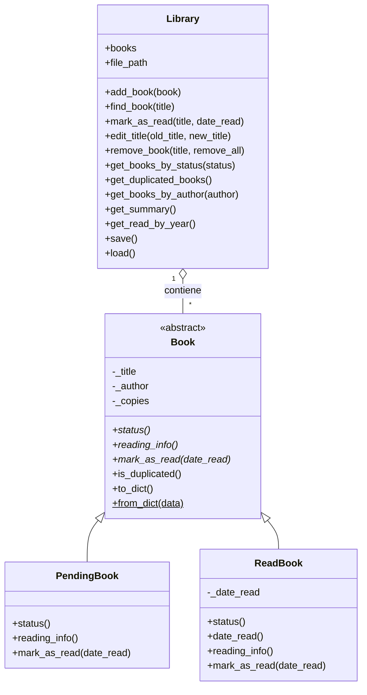

<h1 align="center">📚 Personal Library OOP</h1>

<p align="center"><em>Mi biblioteca personal, hecha con Programación Orientada a Objetos en Python</em></p>

<p align="center">
  
  
  
  
</p>

<pre align="center">
    ┌─┐            ┌───┐            ┌──┐
    │░│┌───┐    ┌─┐│▓▓▓│       ┌───┐│▒▒│
┌──┐│░││▓▓▓│    │░││▓▓▓│┌──┐   │▓▓▓││▒▒│
│▒▒││░││▓▓▓│┌──┐│░││▓▓▓││▒▒│┌─┐│▓▓▓││▒▒│
│▒▒││░││▓▓▓││▒▒││░││▓▓▓││▒▒││░││▓▓▓││▒▒│
│▒▒││░││▓▓▓││▒▒││░││▓▓▓││▒▒││░││▓▓▓││▒▒│
│▒▒││░││▓▓▓││▒▒││░││▓▓▓││▒▒││░││▓▓▓││▒▒│
════════════════════════════════════════
</pre>

> 📖 *Leer es viajar sin moverse del sillón. Esta aplicación guarda el mapa de todos mis viajes.*

Aplicación de consola en Python para gestionar mi biblioteca personal de libros, construida con **Programación Orientada a Objetos (POO)** y aplicando los **4 pilares**: abstracción, encapsulación, herencia y polimorfismo.

Permite registrar libros leídos y pendientes de leer, controlar los duplicados, guardar la fecha de lectura y consultar la biblioteca por estado, por autor o en forma de resumen. Los datos se guardan en un archivo para no perderlos al cerrar el programa.

Además, incluye una **versión web responsive** que reproduce el mismo diseño de clases (ver [Versión web](#versión-web)).

### Un vistazo rápido

- 📗 Libros **leídos**, cada uno con su fecha de lectura
- 📘 Libros **pendientes** de leer
- 📙 **Duplicados** controlados con un contador de ejemplares
- 🔎 Búsqueda **por autor**, sin tildes ni mayúsculas
- 📊 **Resumen** de la biblioteca con lecturas por año
- 💾 Datos **siempre guardados** en `books.json`, con copia de seguridad si el archivo se daña
- 🌐 **Versión web** responsive en la carpeta `web/`

---

## Índice

1. [Objetivo y contexto](#objetivo-y-contexto)
2. [Funcionalidades](#funcionalidades)
3. [POO aplicada](#poo-aplicada)
4. [Diagrama de clases](#diagrama-de-clases)
5. [Estructura del proyecto](#estructura-del-proyecto)
6. [Cómo se guardan los datos](#cómo-se-guardan-los-datos)
7. [Reglas de negocio](#reglas-de-negocio)
8. [Ejemplo de interacción](#ejemplo-de-interacción)
9. [Tecnologías utilizadas](#tecnologías-utilizadas)
10. [Cómo ejecutar el programa](#cómo-ejecutar-el-programa)
11. [Versión web](#versión-web)
12. [Decisiones de diseño](#decisiones-de-diseño)
13. [Control de versiones](#control-de-versiones)
14. [Posibles mejoras](#posibles-mejoras)

## Objetivo y contexto

Este proyecto es el **Reto Nivel III de Python** del bootcamp. Parte del catálogo de libros del Reto II, que estaba hecho con funciones, diccionarios y módulos, y lo amplía a una **biblioteca personal** diseñada con POO, siguiendo la misma metodología del ejercicio de diagrama de clases de *La Casa de Papel* (clase padre abstracta, clases hijas y objetos).

La biblioteca recoge los libros que he leído desde 2022 y los que tengo pendientes. Solo hay libros impresos, por lo que la herencia no se plantea por formato (impreso, ebook, audiolibro), sino por **estado de lectura**: un libro está leído (`ReadBook`) o pendiente (`PendingBook`).

## Funcionalidades

| Opción | Descripción |
|---|---|
| 1. Añadir libro | Pide título, autor y si ya está leído. Si lo está, pide la fecha de lectura (Enter = `2022-01-01` cuando no se recuerda). Si el libro ya existe, suma un ejemplar en lugar de duplicar el registro. |
| 2. Ver todos los libros | Lista toda la biblioteca. |
| 3. Ver libros leídos | Lista solo los leídos. |
| 4. Ver libros pendientes de leer | Lista solo los pendientes. |
| 5. Ver libros duplicados | Lista los libros con más de un ejemplar. |
| 6. Marcar un libro como leído | Convierte un pendiente en leído y pide la fecha de lectura (Enter = hoy). |
| 7. Modificar el título de un libro | Corrige un título mal escrito, sin permitir que coincida con otro libro ya existente. |
| 8. Dar de baja un libro | Elimina un libro o solo un ejemplar si está duplicado, con confirmación previa. |
| 9. Ver resumen de mi biblioteca | Muestra libros distintos, ejemplares, leídos, pendientes, duplicados y leídos por año. |
| 10. Ver libros de un autor | Filtra por autor, sin distinguir mayúsculas ni tildes, y basta con escribir una parte del nombre. |
| 0. Salir | Cierra la aplicación. |

Detalles de los listados: salen **ordenados alfabéticamente** por título (ignorando tildes y mayúsculas), **numerados** y **paginados de 20 en 20**, para no tener que recorrer la terminal línea a línea.

## POO aplicada

| Pilar | Cómo se aplica en el proyecto |
|---|---|
| 🧩 **Abstracción** | `Book` es una clase abstracta (`ABC`): no se puede crear directamente. Define lo que todo libro debe saber hacer (`status`, `reading_info()` y `mark_as_read()`) sin decir cómo. |
| 🌳 **Herencia** | `ReadBook` y `PendingBook` heredan de `Book` y reutilizan sus atributos y métodos comunes. |
| 🎭 **Polimorfismo** | `reading_info()` y `mark_as_read()` se comportan distinto en cada clase hija. `print(book)` funciona igual para todos, pero un libro leído muestra su fecha y uno pendiente muestra `pendiente de leer`. |
| 🔒 **Encapsulación** | Los atributos `_title`, `_author` y `_copies` son privados y se acceden con `@property`, con validación (el título y el autor no pueden estar vacíos y debe haber al menos un ejemplar). El estado (`status`) es de solo lectura y la fecha de lectura solo existe en `ReadBook`. |

Otros conceptos aplicados:

- **Composición:** una `Library` *tiene* una lista de objetos `Book`.
- **Responsabilidad única:** `Book` representa un libro, `Library` gestiona la colección y `main.py` solo habla con el usuario.
- **Separación entre lógica e interfaz:** `Library` nunca usa `print` ni `input`; devuelve resultados (`True`, `False` o textos como `"updated"`) y `main.py` decide qué mensaje mostrar.
- **Método estático de fábrica:** `Book.from_dict()` decide qué clase crear (`ReadBook` o `PendingBook`) según el estado guardado.
- **Método especial:** `__str__` define cómo se muestra un libro.

## Diagrama de clases



Al marcar un `PendingBook` como leído, su método `mark_as_read()` devuelve un `ReadBook` nuevo con el mismo título, autor y ejemplares, y `Library` lo sustituye en la lista.

## Estructura del proyecto

```
personal-library-oop/
├── book.py          # Book (abstracta), PendingBook y ReadBook
├── library.py       # Library: colección, búsquedas, guardado y carga
├── main.py          # Menú interactivo en la terminal
├── README.md
├── .gitignore
├── books.json       # Datos personales (se crea solo; no se sube a GitHub)
└── web/             # Versión web responsive
    ├── index.html   # Estructura de la página
    ├── styles.css   # Diseño responsive y modo claro/oscuro
    └── app.js       # Clases Book y Library + interfaz
```

## Cómo se guardan los datos

Los libros se guardan en `books.json` cada vez que se añade, modifica o elimina algo. Ejemplos:

```json
{
  "title": "Africanus, El hijo del cónsul",
  "author": "Santiago Posteguillo",
  "status": "read",
  "copies": 1,
  "date_read": "2026-10-23"
},
{
  "title": "Todas las noches, todas las ciudades",
  "author": "Dolores Redondo",
  "status": "to_read",
  "copies": 1,
  "date_read": null
}
```

- Al cargar, `status` decide qué clase se crea: `"read"` genera un `ReadBook` y `"to_read"` un `PendingBook`.
- El archivo contiene datos personales, por eso está en el `.gitignore` y no se sube al repositorio.
- **Protección ante errores:** si `books.json` tiene un fallo de formato, el programa guarda una copia en `books.json.bak` y muestra la línea y la columna exactas del error, en lugar de sobrescribir los datos con una lista vacía.

## Reglas de negocio

- **Duplicados:** un libro con el mismo título (sin distinguir mayúsculas) no se registra dos veces; se suma un ejemplar a `copies`. La versión web considera duplicado cualquier libro con `copies` mayor que 1 o con el mismo título que otro, ignorando mayúsculas y tildes.
- **Pendientes sin fecha:** un libro pendiente no tiene fecha de lectura. Se pide la fecha al marcarlo como leído.
- **Fecha comodín:** los libros leídos cuya fecha exacta no se conoce se registran con `2022-01-01`, para poder contarlos por año.
- **Un libro leído no cambia de fecha:** marcarlo de nuevo no sobrescribe la fecha original.
- **Dar de baja:** si el libro tiene varios ejemplares, se puede quitar solo uno o todos. Siempre se pide confirmación.
- **Validaciones:** título y autor no pueden estar vacíos y el número de ejemplares no puede ser menor que 1.

## Ejemplo de interacción

```
--- Mi biblioteca personal ---
1. Añadir libro
2. Ver todos los libros
3. Ver libros leídos
4. Ver libros pendientes de leer
5. Ver libros duplicados
6. Marcar un libro como leído
7. Modificar el título de un libro
8. Dar de baja un libro
9. Ver resumen de mi biblioteca
10. Ver libros de un autor
0. Salir
Elige una opción: 1
Título del libro: Africanus, El hijo del cónsul
Autor: Santiago Posteguillo
¿Ya lo has leído? (s/n): s
Fecha de lectura (AAAA-MM-DD, Enter = 2022-01-01): 2026-10-23
Libro añadido a la biblioteca.

Elige una opción: 10
Autor (basta con una parte del nombre): posteguillo
1. Africanus, El hijo del cónsul - Santiago Posteguillo [read] x1 (leído: 2026-10-23)
--- Total: 1 libros ---

Elige una opción: 4
1. Todas las noches, todas las ciudades - Dolores Redondo [to_read] x1 (pendiente de leer)
--- Total: 1 libros ---
```

## Tecnologías utilizadas

- **Python 3** (versión 3.8 o superior)
- Solo librería estándar, sin instalar nada: `abc`, `json`, `pathlib`, `shutil`, `datetime` y `unicodedata`
- **HTML5, CSS3 y JavaScript (ES6+)** para la versión web, sin librerías externas
- **Git y GitHub** para el control de versiones
- **PyCharm** (Python) y **VS Code** con la extensión Live Server (web) como entornos de desarrollo

## Cómo ejecutar el programa

1. Clona el repositorio:

   ```
   git clone https://github.com/mjrr39sevilla/personal-library-oop.git
   cd personal-library-oop
   ```

2. Ejecuta la aplicación:

   ```
   python main.py
   ```

La primera vez, la biblioteca estará vacía y `books.json` se creará automáticamente al añadir el primer libro.

## Versión web

La carpeta [`web/`](./web) contiene una versión web responsive que reproduce el mismo diseño orientado a objetos: las clases `Book` y `Library` tienen los mismos métodos que en Python, escritos en JavaScript.

**Qué permite hacer**

- Añadir libros, editar su título y darlos de baja.
- Marcar un libro como leído con su fecha.
- Consultar los libros **leídos**, **pendientes**, **duplicados** y **por año**, siempre en orden alfabético.
- Buscar por título o autor y ver estadísticas (total, leídos, pendientes y duplicados).
- Importar y exportar la biblioteca en formato JSON, con el mismo formato que `books.json`.

**Cómo ejecutarla**

1. Abre la carpeta del proyecto en VS Code e instala la extensión **Live Server**.
2. Clic derecho sobre `web/index.html` → **Open with Live Server**.
3. Pulsa **Importar** y selecciona tu `books.json` para cargar tus libros.

Los datos de la web se guardan en el navegador (`localStorage`), por lo que no se pierden al recargar. No se sincronizan con `books.json`: lo que se cambia en la web no se escribe en el archivo de Python.

**Aprendizajes**

- Trasladar un diseño POO de Python a JavaScript.
- Usar `localStorage` e importar archivos JSON.
- Organizar el código en HTML, CSS y JavaScript por separado.
- Trabajar con Git haciendo commits pequeños y descriptivos.

## Decisiones de diseño

- **Herencia por estado de lectura y no por formato:** solo tengo libros impresos, así que `ReadBook` y `PendingBook` representan mejor mi caso. Además hacen imposible un estado incoherente, como un libro pendiente con fecha de lectura.
- **`copies` en lugar de registros repetidos:** un duplicado es el mismo libro con más de un ejemplar, no una fila nueva.
- **Libros nuevos en la lista, sin tocar el formato JSON:** el archivo conserva la misma estructura, y los libros ya guardados se cargan sin cambios.
- **`Library` no imprime:** así la lógica se puede reutilizar con otra interfaz, como ya se hace en la versión web, donde la función `render()` dibuja los datos.
- **Misma POO en dos lenguajes:** `Book` y `Library` mantienen los mismos métodos en Python y en JavaScript; solo cambia la sintaxis.
- **Ordenar solo al mostrar:** se ordena una copia de la lista, de modo que el orden de `books.json` no cambia.
- **Web responsive:** CSS Grid, Flexbox y `@media` para adaptarla a móvil, tablet y ordenador.
- **Idioma:** código, clases, métodos y variables en inglés; mensajes y preguntas de la terminal en español.

## Control de versiones

- Repositorio propio, separado del Reto II (`Books-Santiago-Posteguillo`), para no modificar el trabajo ya entregado.
- Commits siguiendo **Conventional Commits**: `feat:` (funcionalidad nueva), `fix:` (corrección), `refactor:` (reorganización del código), `docs:` (documentación) y `chore:` (mantenimiento).
- `.gitignore` con `.venv/`, `.idea/`, `__pycache__/`, `books.json` y `*.bak`.

## Posibles mejoras

- Editar el autor de un libro desde el menú.
- Búsqueda por título en la consola (la web ya la tiene).
- Tests automáticos para `Book`, `ReadBook`, `PendingBook` y `Library`.
- Nuevas subclases si algún día aparecen otros formatos (ebook, audiolibro).
- Publicar la versión web con GitHub Pages y sincronizarla con `books.json`.

---

<pre align="center">
    ┌─┐            ┌───┐            ┌──┐
    │░│┌───┐    ┌─┐│▓▓▓│       ┌───┐│▒▒│
┌──┐│░││▓▓▓│    │░││▓▓▓│┌──┐   │▓▓▓││▒▒│
│▒▒││░││▓▓▓│┌──┐│░││▓▓▓││▒▒│┌─┐│▓▓▓││▒▒│
│▒▒││░││▓▓▓││▒▒││░││▓▓▓││▒▒││░││▓▓▓││▒▒│
│▒▒││░││▓▓▓││▒▒││░││▓▓▓││▒▒││░││▓▓▓││▒▒│
│▒▒││░││▓▓▓││▒▒││░││▓▓▓││▒▒││░││▓▓▓││▒▒│
════════════════════════════════════════
</pre>

<p align="center">📚 Hecho con Python, orden y muchas lecturas · Reto Nivel III</p>